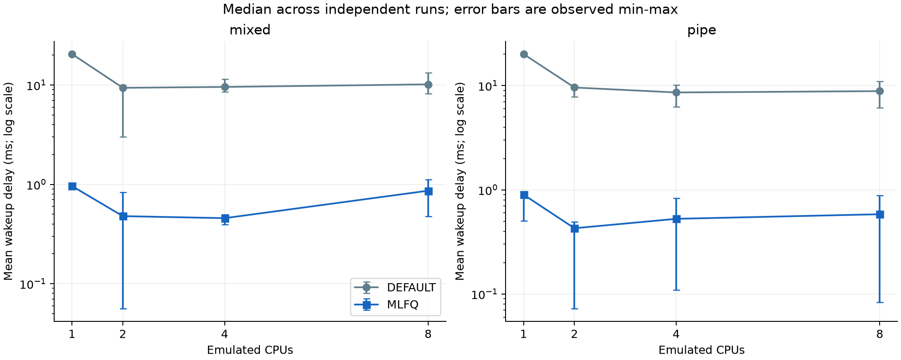
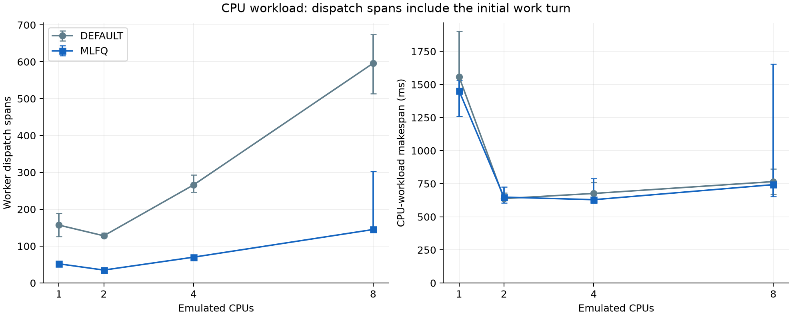
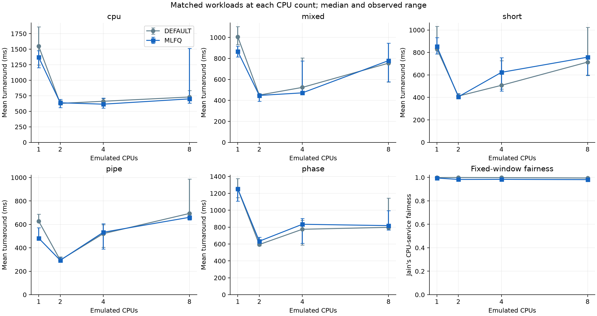
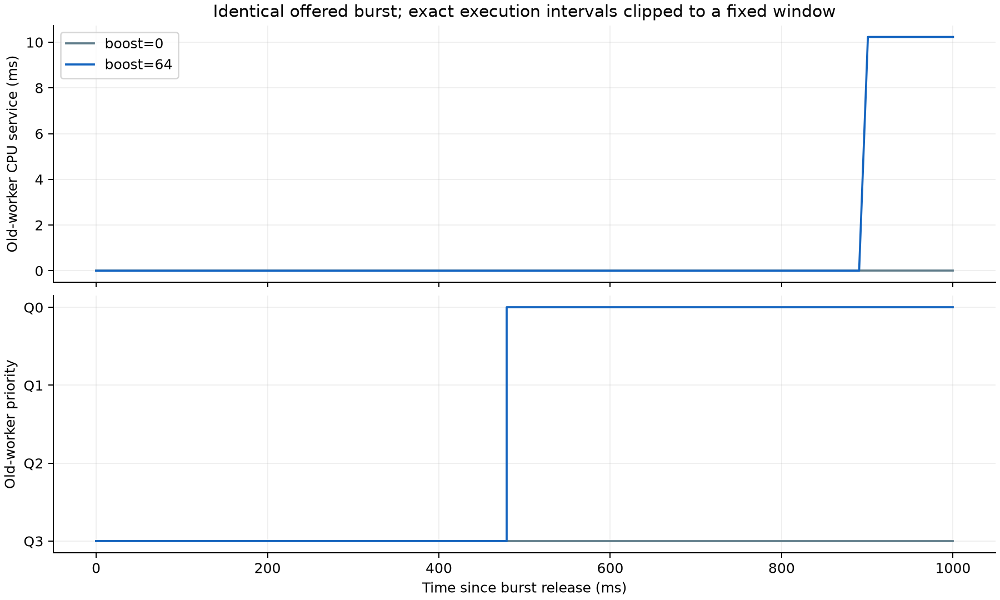

# Multicore MLFQ implementation and evaluation

## Implementation

Four shared FIFO priority queues use a single policy lock. Lifecycle/context
handoff uses the existing process locks. A peek-lock-revalidate claim protocol
prevents stale selections and duplicate CPU ownership. Only the process lock
crosses a context switch.

Execution is charged using elapsed shared-counter time across dispatch,
timers, blocking, yield, exit, and snapshots. Quanta rotate peers; separate
allotments control demotion. Partial and excess execution are retained.
Boosts close running intervals before resetting live budgets; sleepers remain
asleep. Runtime configuration is validated and atomic. Affinity can migrate a
caller before returning. Trace toggling preserves budgets and the boost deadline.

DEFAULT retains xv6's table-order per-CPU selection and timer yielding, with
the same accounting, timer, affinity checks, and invariant setting as MLFQ.
The comparison uses two instrumented policies rather than a pristine old binary.
[DESIGN.md](DESIGN.md) defines the synchronization and scheduling rules.

## Correctness evidence

The completed matrix has **72 passing guest validation boots** across
both policies and 1, 2, 4, and 8 CPUs. It includes complete upstream suites,
seeded stress, targeted assertions, trace replay, and overflow checks.
Stress completed **48,000 top-level actions**, with additional checked work
in forked children. The independent replay validator passed
13 positive/negative self-tests.

| CPUs | Policy | Upstream tests | Seeded actions | Replay events |
| --- | --- | ---: | ---: | ---: |
| 1 | DEFAULT | 75 passed | 6,000 | 1,321 |
| 1 | MLFQ | 75 passed | 6,000 | 1,162 |
| 2 | DEFAULT | 75 passed | 6,000 | 1,322 |
| 2 | MLFQ | 75 passed | 6,000 | 1,180 |
| 4 | DEFAULT | 75 passed | 6,000 | 1,375 |
| 4 | MLFQ | 75 passed | 6,000 | 1,198 |
| 8 | DEFAULT | 75 passed | 6,000 | 1,319 |
| 8 | MLFQ | 75 passed | 6,000 | 1,209 |

The other supported CPU counts (3, 5, 6, and 7) passed 32 additional
rule/stress/replay/overflow boots. Across both matrices, seeded top-level
actions total 57,600.

Assertions cover exact CPU-by-level/core and process state-time conservation,
budget persistence, quanta/allotments, demotion, parallel ownership, affinity,
migration, fairness, preemption, boosts, inheritance, exec, slot reuse,
kill/sleep races, and concurrent configuration. Trace replay checks each
priority/FIFO choice and exact execution interval. Negative inputs exercise
wrong ordering, ownership, affinity, budgets, timestamps, and missing records.
Trace dumps freeze capture before console printing to prevent self-overwrite.

Raw logs and source/kernel hashes are retained in `results/v2/validation/`.
Expected invalid-memory/out-of-space messages in upstream tests are followed
by their normal passing verdicts.

## Measurement protocol

Platform: QEMU emulator version 8.2.2 (Debian 1:8.2.2+ds-0ubuntu1.18); riscv64-linux-gnu-gcc (Ubuntu 13.3.0-6ubuntu2~24.04.1) 13.3.0; Linux-6.6.87.2-microsoft-standard-WSL2-x86_64-with-glibc2.39.
Host CPU: Intel(R) Core(TM) Ultra 7 255H;
16 logical CPUs available to the runner.
The device tree independently verifies a 10,000,000 Hz clock.
The timer interval is 100,000 units, nominally 10 ms.
Automatic invariant scans are enabled in both builds.

The main matrix uses 5 repetitions of six workloads, two
policies, and four CPU counts: **240 independent benchmark
boots**. Worker count is `max(4,2*CPUs)`. Each fixed work unit performs 100,000
dependent arithmetic iterations. Fixed-work checksums must match.

CPU, mixed, short-job, pipe, phase-change, and fixed-window fairness workloads
use a common release barrier. Timed statistics exclude pre-barrier work.
Completed workers park until all timed work ends, then serialize their results.
Each boot uses independent kernel/disk copies. Policy order alternates across
repetitions. Trace capture is disabled for performance measurements.

Analysis first computes per-run metrics, then reports medians and observed
min/max ranges. Error bars are not confidence intervals. Workers within one
guest are not treated as independent repetitions. CPU residency includes
kernel/lock time while dispatched; it is not host-thread CPU time.

## Responsiveness

Wakeup delay uses only observations within the timed phase. Pipe message
latency is separately retained from send timestamp to read receipt.

| CPUs | Mixed DEFAULT ms | MLFQ ms | Pipe DEFAULT ms | MLFQ ms |
| --- | ---: | ---: | ---: | ---: |
| 1 | 20.540 | 0.962 | 20.077 | 0.898 |
| 2 | 9.375 | 0.479 | 9.591 | 0.428 |
| 4 | 9.573 | 0.457 | 8.595 | 0.526 |
| 8 | 10.156 | 0.864 | 8.854 | 0.583 |

## CPU completion and fairness

Dispatch spans include the initial turn containing measured work and subsequent
dispatches. They are an event-count proxy, not scheduler instruction overhead.

| CPUs | CPU turnaround DEFAULT ms | MLFQ ms | Dispatch spans DEFAULT | MLFQ |
| --- | ---: | ---: | ---: | ---: |
| 1 | 1548.210 | 1370.482 | 157.0 | 52.0 |
| 2 | 627.077 | 637.073 | 128.0 | 35.0 |
| 4 | 661.668 | 614.864 | 266.0 | 70.0 |
| 8 | 730.226 | 700.192 | 596.0 | 145.0 |

| CPUs | Jain fairness DEFAULT | MLFQ | Short-job DEFAULT ms | MLFQ ms |
| --- | ---: | ---: | ---: | ---: |
| 1 | 0.9991 | 0.9949 | 199.217 | 229.340 |
| 2 | 0.9995 | 0.9828 | 92.405 | 81.296 |
| 4 | 0.9981 | 0.9837 | 136.391 | 83.550 |
| 8 | 0.9950 | 0.9812 | 121.209 | 95.953 |

Fair workers check the shared deadline between work chunks. The largest
finish-checkpoint overshoot was 8.935 ms. Reported service extends
through each stop checkpoint rather than clipping exact trace intervals.

Fairness uses identical workers over a common window, not final fixed-work
service totals. Short-job behavior is reported separately from workload means.
Longer peer turns, feedback classification, boosts, and idle CPU availability
produce tradeoffs; MLFQ is not guaranteed to win every metric.

## Fixed-work scaling

The main matrix changes worker count with CPU count. A separate experiment
holds eight workers and their arithmetic input fixed, with three repetitions.

| CPUs | Makespan DEFAULT ms | MLFQ ms | DEFAULT speedup | MLFQ speedup |
| --- | ---: | ---: | ---: | ---: |
| 1 | 2723.485 | 2680.023 | 1.00x | 1.00x |
| 2 | 1285.170 | 1297.474 | 2.12x | 2.07x |
| 4 | 656.502 | 635.853 | 4.15x | 4.21x |
| 8 | 357.587 | 358.870 | 7.62x | 7.47x |

Speedup divides each policy's single-core median makespan by its multicore
median. Ideal linear scaling would equal the CPU count; shared locks and
emulation can limit it.

## Parameter sensitivity

Additional four-core profiles use three repetitions of mixed and phase-change
workloads under both policies. The table shows MLFQ; matched DEFAULT records
are retained. Default measurements come from the main matrix.

| Profile | Quanta | Allotments | Boost | Mixed wake ms | Phase turnaround ms |
| --- | --- | --- | ---: | ---: | ---: |
| Default | 1,2,4,8 | 2,4,8,16 | 100 | 0.457 | 1007.496 |
| short_slices | 1,1,2,4 | 2,2,4,8 | 32 | 0.496 | 587.908 |
| long_slices | 2,4,8,16 | 4,8,16,32 | 256 | 0.912 | 717.783 |
| no_boost | 1,2,4,8 | 2,4,8,16 | 0 | 0.462 | 745.984 |

This is a sensitivity study, not exhaustive tuning or a claim of optimal defaults.

## Controlled boost ablation

The same 40 CPU jobs are pre-created, verified sleeping, and released by one
bounded pipe write. Each requests at least 40 ms on CPU0. A preexisting Q3 job
competes with the burst. Its exact CHARGE intervals are clipped to a fixed
one-second window. Actual admission spread must remain below one timer period.

| Boost ticks | Jobs | Window ms | Old-job CPU ms | Admission spread ms |
| --- | ---: | ---: | ---: | ---: |
| 0 | 40 | 1000.0 | 0.000 | 0.283 |
| 64 | 40 | 1000.0 | 10.231 | 0.092 |

Both traces pass independent replay. This is a bounded empirical progress
check, not a universal starvation or deadline guarantee.

## Limits and reproduction

Shared queues target eight CPUs and 64 slots. There are no rescheduling IPIs,
per-CPU work-stealing queues, or scheduling-group fairness. Synthetic arithmetic,
blocking, and pipe jobs do not cover arbitrary workloads or physical disk I/O.
Emulation, host load, and invariant instrumentation affect measured performance.
No unrecorded latency percentiles or significance claims are inferred.

The root README reproduces validation, evaluation, and source export.
[TESTING.md](TESTING.md) specifies controls and assertions. Current evidence
is under `results/v2/`; earlier single-core data is historical.

References: [MIT xv6-riscv](https://github.com/mit-pdos/xv6-riscv),
[OSTEP MLFQ](https://pages.cs.wisc.edu/~remzi/OSTEP/cpu-sched-mlfq.pdf).
