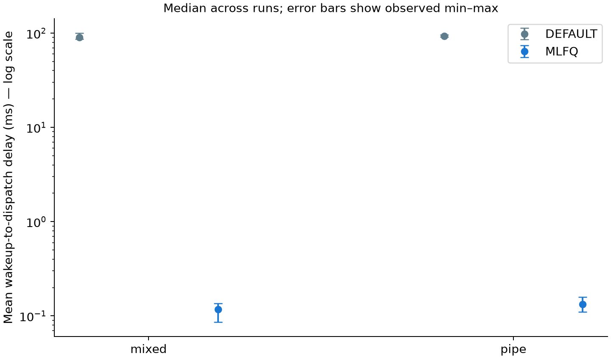
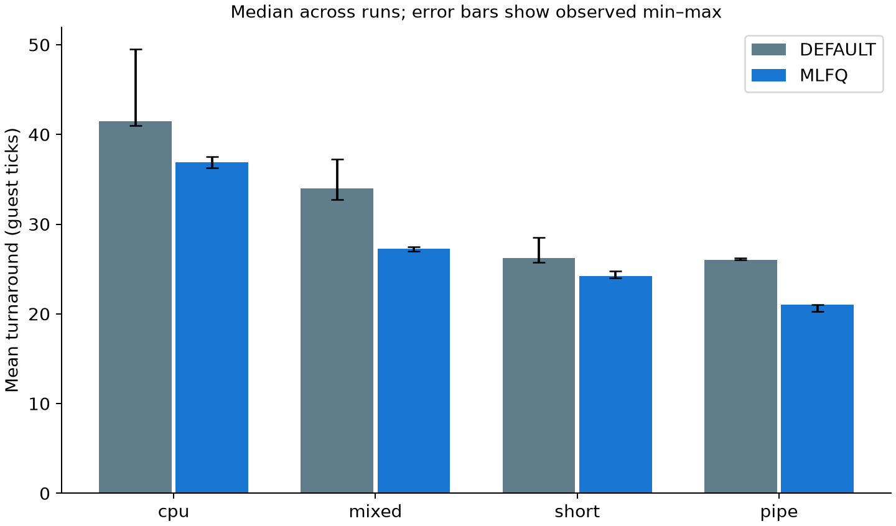
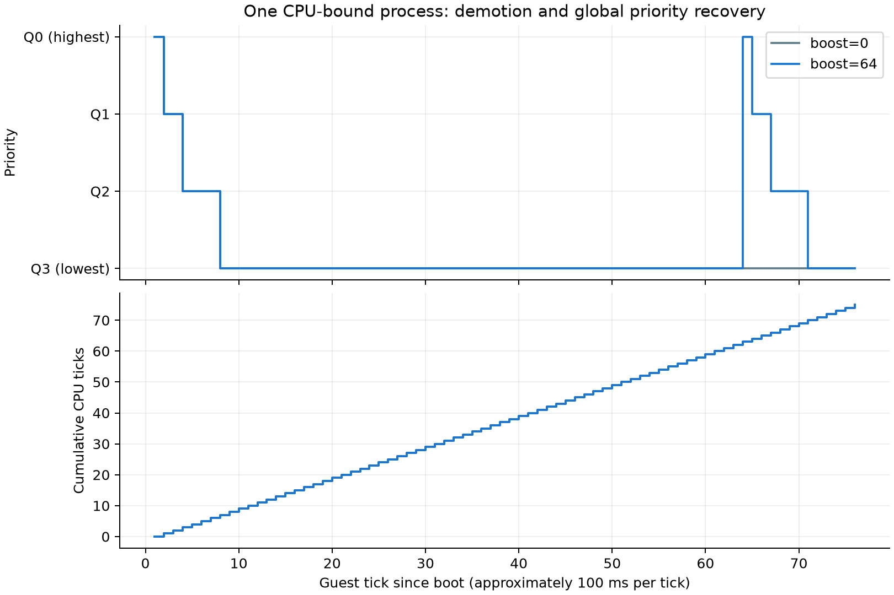

# Implementing and evaluating MLFQ in xv6-riscv

Aayush Kuloor — CS 330 Operating Systems  
19 November 2026

## Objective

Implement a Multilevel Feedback Queue scheduler in xv6 and compare it with
xv6's default policy using CPU-bound and blocking workloads. The implementation
supports dynamic CPU-based priorities, configurable time slices, periodic
priority boosting, and per-process scheduling statistics.

The project uses MIT xv6-riscv commit
`fa2ddcb7ca87a77af579380a6eafd5aff163b44f`. The kernel-hacking approach is
inspired by the OSTEP xv6 scheduling project; that assignment uses lottery
scheduling. Our policy follows the MLFQ ideas described in OSTEP chapter 8.

## Design

Four logical queues are stored in the existing process table. A process's
priority level selects its queue; a monotonically increasing FIFO position
selects its order among peers. The scheduler scans the table for the smallest
`(level, FIFO position)` pair. This avoids separate run-queue data structures
and locks, at an O(NPROC) selection cost. xv6 permits 64 process slots.

The default quanta are 1, 2, 4, and 8 ticks. Each level's allotment equals one
quantum. A process begins at Q0, accumulates charged CPU time, and is demoted
when its allotment expires. At Q3 it rotates without further demotion. Sleep
preserves its level and consumed budget. Higher-priority preemption also
preserves its partial quantum. `exec` retains history; fork creates a fresh-Q0
child with zero lifetime counters.

Every 64 ticks, a global boost resets live running, runnable, and sleeping
processes to Q0 with fresh budgets. Sleepers remain asleep. Runnable FIFO
positions retain their relative order; the running process moves to the tail.
Counters retain their lifetime totals. CPU charging precedes boosting on a
tick where both expiry and boosting occur.

The implementation deliberately uses one CPU. Process locks and disabled
interrupts serialize state changes and candidate selection. No extra kernel
lock is introduced, and only the process lock crosses a context switch.
The Makefile rejects other CPU counts. The timer period remains the upstream
1,000,000 time-counter units, approximately 100 ms on QEMU virt.

`getpinfo` exports a bounded process snapshot. `waitstats` returns finalized
child statistics before freeing its slot and shares the original wait logic.
CPU service, runnable waiting, sleeping, dispatches, demotions, boosts, queue
service, and timestamps are recorded. Wakeup-to-dispatch latency uses the finer
RISC-V time counter rather than rounding to scheduler ticks.

The detailed state transitions, synchronization assumptions, and metric
definitions are in [DESIGN.md](DESIGN.md). Likely oral questions and small
modifications are in [WALKTHROUGH.md](WALKTHROUGH.md), with corresponding
comments beside the kernel code.

## Correctness evidence

The pristine upstream baseline passed `forktest` and `usertests -q`. Both the
instrumented DEFAULT and MLFQ builds then passed those checks. The upstream
quick suite includes process creation, exec, kill, wait, preemption, memory,
pipe, filesystem, and lazy-allocation tests. Expected invalid-memory traps
printed by some upstream tests are followed by their normal passing verdicts.

The custom `schedtest` program checks:

- Valid snapshots, invalid pointers/slots, and safe waitstats retries.
- Fresh children and process-slot reuse without inherited counters.
- Exact CPU allotments on descent and continued bottom-queue service.
- Budget preservation across sleep and multi-tick execution without needless yields.
- Progress and bounded service skew among three competing CPU workers.
- Higher-priority wakeup preemption and cleanup of a killed background worker.
- Boosting a low-priority sleeper without prematurely waking or charging it.

Tests also passed with boosting disabled and with quanta `[2,4,8,16]` and a
128-tick boost interval. Tests that depend on a disabled feature explicitly
skip it. The full slow upstream suite was not run; the retained upstream
regression results are the quick suite.

Logs: `results/raw/upstream.log`, `mlfq-regression.log`,
`default-regression.log`, and `results/diagnostics/rules-*.log`.

## Experimental method

Environment: Ubuntu under WSL 2, QEMU 8.2.2, RISC-V GCC 13.3.0, 128 MB guest
memory, one emulated CPU, and the unchanged upstream timer. Both policies use
the same instrumentation. The DEFAULT build retains upstream table-order
selection and timer yielding.

Four workloads use four workers each:

| Workload | Composition |
| --- | --- |
| CPU | Four identical fixed-arithmetic workers, 400 work units each |
| Mixed | Three such CPU workers and a worker alternating short CPU bursts with timed blocking |
| Short | Three 400-unit jobs and one 51-unit job |
| Pipe | Two CPU workers, a periodic producer, and a blocking pipe reader |

One unit performs one million dependent arithmetic iterations with a volatile
checksum. Blocking/pipe workloads perform 21 periodic iterations. Work is fixed
between policies, and checksums are verified across runs. A pipe barrier
provides a common release timestamp. Console result printing happens in the
parent after collecting worker result records.

There are **10 repetitions per workload per policy: 80 independent boots and
320 worker records**. Policy order alternates by repetition. Each workload gets
a fresh QEMU boot. Run metadata, source hashes, raw serial logs, and CSV are
retained in `results/main/`. Kernel and workload code used for evaluation is
unchanged after collection; a later test-only fix made the BOOST=0 test build
compile cleanly and explicitly skip an inapplicable short-boost setup. Metadata
records the original and delivered full-source hashes and this distinction.

Turnaround is exit tick minus shared release tick. Initial response is release
to the worker's first work after the barrier. Wakeup latency measures the
sleeping-to-runnable-to-running path. Lifetime wakeup statistics can include
the start-barrier wait if it occurred. Dispatches count scheduler entries into
RUNNING, including possible reselection of the same process.

For each run, we calculate workload mean turnaround, mean initial response,
total worker dispatches, and the special worker's turnaround. Wakeup latency is
the blocking/reader worker's mean over its completed wakeups. The table below
then reports the median of those per-run values. Figure error bars show the
observed minimum and maximum, not confidence intervals. Workers from one run
are not treated as independent repetitions.

## Results

| Measurement | DEFAULT median | MLFQ median |
| --- | ---: | ---: |
| CPU mean turnaround, ticks | 41.50 | 36.875 |
| CPU total dispatches | 46 | 16 |
| CPU throughput, jobs / nominal guest second | 0.952 | 0.952 |
| Mixed mean turnaround, ticks | 34.00 | 27.25 |
| Mixed blocking-worker turnaround, ticks | 42.5 | 24.0 |
| Mixed blocking-worker mean wakeup delay, ms | 90.396 | 0.117 |
| Pipe reader mean wakeup delay, ms | 93.562 | 0.132 |
| Pipe reader turnaround, ticks | 31 | 22 |
| Short-workload mean turnaround, ticks | 26.25 | 24.25 |
| Short job's own turnaround, ticks | 7 | 10 |

Source: `results/main/summary.csv`. One tick is nominally about 100 ms. CPU and
turnaround measurements use tick resolution; finer decimal values in means
and medians do not imply finer timestamps.

The strongest responsiveness result is the blocking worker's wakeup delay.
While CPU jobs descend to lower queues, the frequently blocking worker
accumulates little sampled CPU service. It can therefore run promptly after
waking. The pipe workload independently exercises actual blocking reads;
timed sleep in the mixed workload is only an I/O-like proxy.

MLFQ reduced the measured mean turnaround on these workloads. In the CPU-only
case, longer lower-priority turns let earlier workers finish sooner, while
the median full-workload throughput remained the same. Dispatches fell from
46 to 16. This is evidence of fewer dispatch events, not a direct measurement
of scheduler instruction overhead or a claim of higher CPU execution speed.

The short CPU job is a counterexample to a blanket performance claim: its
turnaround increased from 7 to 10 ticks. All jobs initially receive high
priority. Once they descend, the short job can wait behind longer peer turns
before receiving its remaining CPU time. The short-workload average still
improved, so reporting only that average would hide this regression.

Initial response also did not improve consistently: median mean initial
response was about 106.15 vs 111.26 ms for CPU work, and 117.27 vs 118.26 ms
for mixed work. Improving wakeup response after feedback has classified jobs
does not guarantee better first response for a batch of new jobs.

## Priority recovery and admission pressure

The diagnostic trace shows a CPU-bound job descending through the levels,
remaining at Q3 without boosts, and returning to Q0 at the global boost with
boosting enabled. The trace prints once per observed tick and is excluded
from performance measurements.

The admission-pressure diagnostic first lets an old job reach Q3. Starting
around tick 40, a generator creates fresh Q0 work while the old job remains
runnable. Its bounded arrival count fits inside the process table.

| Boost interval | Observed window | New arrivals | Old job CPU ticks in window | Maximum runnable wait |
| --- | --- | ---: | ---: | ---: |
| Disabled | 40–80 | 40 | 0 | 40 ticks |
| 64 ticks | 40–89 | 24 | 1 | 24 ticks |

The enabled case crosses the boost at tick 64, giving the old job another
high-priority opportunity. The generator is itself scheduled, so boosting
changes its arrival count and actual stop time. This is a qualitative progress
diagnostic with endogenous arrivals, not a matched-rate performance benchmark
or a universal starvation bound. Its raw observations are in
`results/diagnostics/pressure.csv`.

## Limitations and further work

- Single-CPU scope is intentional; SMP needs additional synchronization and
  cross-core policy decisions.
- CPU accounting samples timer interrupts. Sub-tick bursts may report zero CPU
  and can game feedback. Fresh-Q0 fork can also be used to regain priority.
- The 100 ms timer is coarse. High-resolution wakeup timestamps help measure
  delays but do not make CPU charging exact.
- Global boosts can temporarily increase latency by promoting many jobs at once.
- Synthetic arithmetic, timed blocking, and pipe workloads cover specific
  behavior; they do not represent arbitrary applications or physical disk I/O.
- Host load and emulation affect results. Repetitions and observed ranges expose
  variability, but the study does not provide formal significance tests.
- The default parameters are illustrative. Alternate settings were tested for
  correctness, not exhaustively tuned for performance.

The project demonstrates a compact working MLFQ implementation, correct
budget/state handling under the exercised tests, and reproducible tradeoffs
against xv6's default scheduler. Higher-resolution CPU accounting and separate
multi-quantum allotments would be the next extensions before attempting SMP.

## Reproduction and references

Run the commands in the root README. `scripts/benchmark.py` recreates raw data,
`scripts/analyze.py` recreates summaries and figures, and the diagnostic scripts
recreate the boost/progress examples.

- [MIT xv6-riscv](https://github.com/mit-pdos/xv6-riscv).
- [OSTEP chapter 8: MLFQ](https://pages.cs.wisc.edu/~remzi/OSTEP/cpu-sched-mlfq.pdf).
- [OSTEP xv6 lottery scheduling project](https://github.com/remzi-arpacidusseau/ostep-projects/tree/master/scheduling-xv6-lottery).
- [MIT toolchain guidance](https://pdos.csail.mit.edu/6.S081/2024/tools.html).
